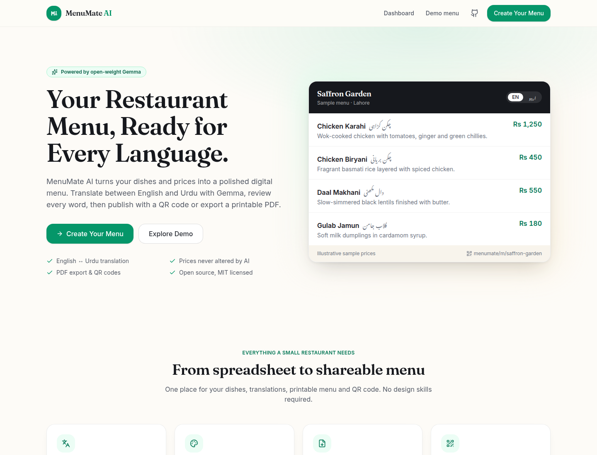
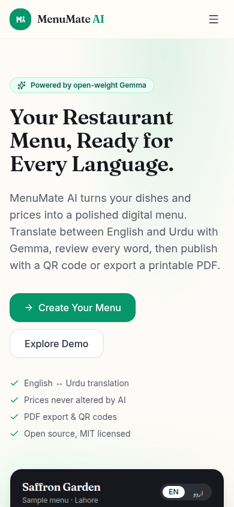
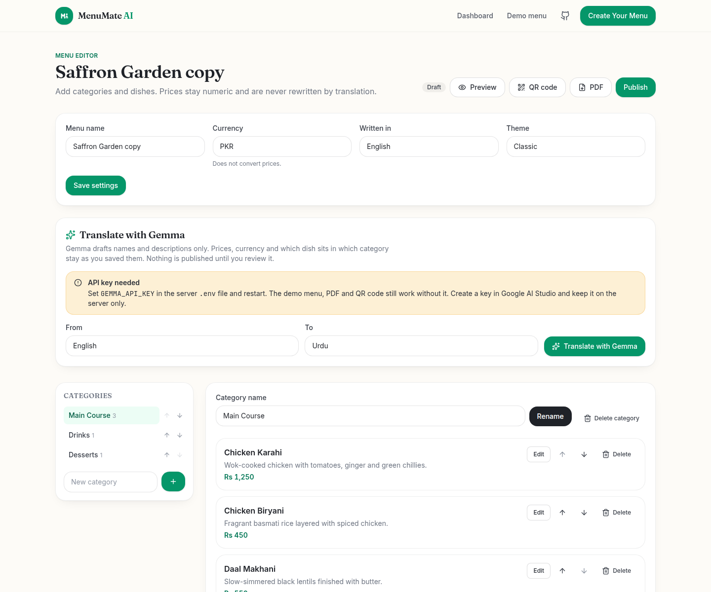
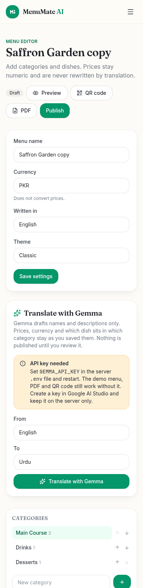
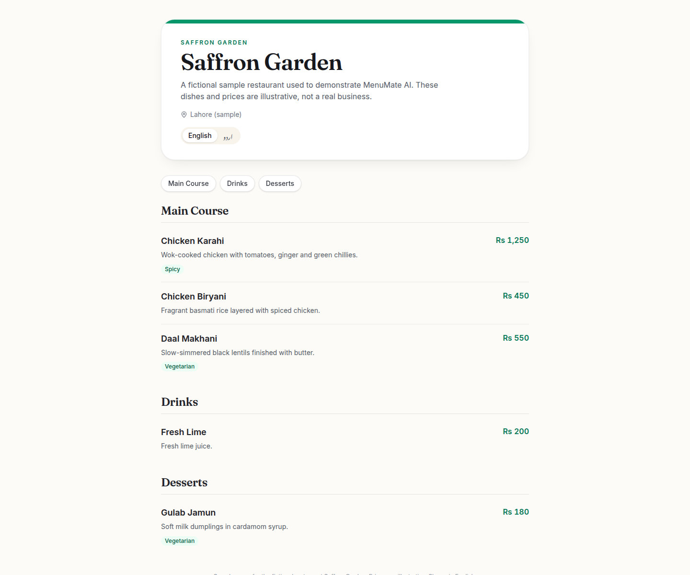
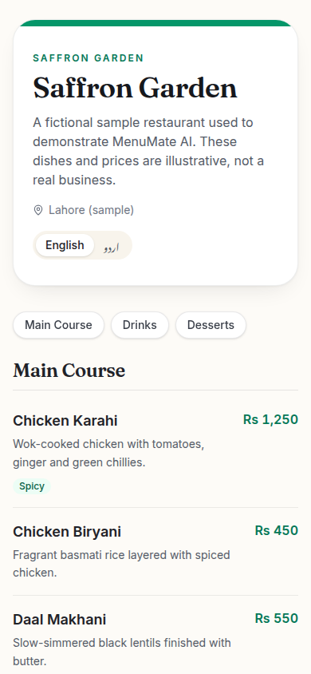

# MenuMate AI

MenuMate AI is a multilingual restaurant menu builder. An owner writes each dish once, in English or Urdu, reviews a Gemma translation, and publishes a public menu with a QR code and a printable PDF.

Prices, currency, and which dish belongs to which category stay under the owner's control. The model is only asked for names and descriptions, and the server drops anything else it returns.

This is a single-owner MVP. There is no login. It is meant to be run locally, or deployed later with authentication added before more than one person should use the dashboard.

## Problem

Independent restaurants often maintain a separate menu for every language, then retype prices into a PDF and a phone photo for guests. Those copies drift. A translated price that does not match the bill is worse than no translation.

MenuMate keeps one saved menu. Guests switch between English and Urdu on a public page. The owner downloads a PDF and a QR code from that same saved data.

## Features

- Restaurant profile and menu editor with categories, dishes, dietary labels, availability, and drag-free reorder controls.
- English and Urdu. Urdu public pages and the editor preview use right-to-left layout.
- Classic and Modern themes.
- Publish and unpublish. Unpublished links explain that the menu is not public, without listing the dishes.
- Public URL, copy link, and a PNG QR code. Local URLs are labeled as reachable only by devices that can see that machine.
- PDF download in the selected language. Urdu is shaped with Noto Naskh Arabic so letters join.
- Sample restaurant **Saffron Garden** (fictional, with illustrative prices) that works with no API key and cannot be overwritten in place.
- Gemma translation and description improvement when `GEMMA_API_KEY` is set. Suggestions are reviewed before they are saved.

## Screenshots

These files are screenshots of this app running locally. They are not a deployed site.













## Architecture

```
browser  →  React (Vite)  →  /api  →  Express  →  SQLite
                                      ↘  Gemini API (Gemma), only for AI routes
```

- `client/` is the React app. In development, Vite proxies `/api` to the API. In production, Express serves `client/dist` and the API on one origin.
- `server/` is Express 5. Routes validate input with Zod. SQLite (via `better-sqlite3`) stores the restaurant, menus, categories, dishes, translations, and publish state.
- `shared/` holds the schemas and language helpers used by both sides.

The dashboard edits the earliest restaurant that is not the demo. Saffron Garden is a separate `is_demo` row, so changing your profile does not replace the sample.

## Tech stack

- Node.js 22, TypeScript, npm workspaces
- React 19, React Router 7, Vite 7, Tailwind CSS 4
- Express 5, Zod 4, better-sqlite3
- PDFKit for Latin text, `@napi-rs/canvas` plus Noto Naskh Arabic for Urdu shaping
- `qrcode` for QR PNGs

## Setup

Requirements: Node.js 22 or newer, and npm.

```bash
npm ci
cp .env.example .env
npm run dev
```

- App: http://localhost:5173
- API: http://localhost:3001
- Sample menu: http://localhost:5173/m/saffron-garden

The first server start creates `./data/menumate.sqlite` and seeds Saffron Garden if that slug is missing.

To run the production build locally:

```bash
npm run build
NODE_ENV=production APP_BASE_URL=http://localhost:3001 npm start
```

`npm start` listens on `PORT` (default 3001) and reads `../.env` when that file exists. Open http://localhost:3001.

## Environment variables

Copy [`.env.example`](.env.example). The important ones:

| Variable | Role |
| --- | --- |
| `PORT` | API port. Default `3001`. Render sets this in production. |
| `DATABASE_PATH` | SQLite file. Default `./data/menumate.sqlite`. Use `:memory:` only in tests. |
| `APP_BASE_URL` | Origin encoded in QR codes and the public link. |
| `GEMMA_API_KEY` | Server-only key. Empty disables AI. |
| `GEMMA_PROVIDER` | `google` (default) or `openai-compatible`. |
| `GEMMA_MODEL` | Default `gemma-4-31b-it`. |
| `GEMMA_API_BASE_URL` | Default Gemini API base. |
| `GEMMA_THINKING_LEVEL` | `minimal` or `high`. |
| `AI_RATE_LIMIT_PER_15_MIN` | Limit for `POST /api/ai/*`. |

Never commit `.env`. A placeholder key in the example file is empty on purpose.

## How Gemma is integrated

Checked against Google's docs on 16 October 2026:

- Guide: [Gemma on the Gemini API](https://ai.google.dev/gemma/docs/core/gemma_on_gemini_api)
- Auth: [Using API keys](https://ai.google.dev/gemini-api/docs/api-key) (`x-goog-api-key` header)

The default provider is Google's Gemini API hosting Gemma open-weight models. The default model id is **`gemma-4-31b-it`**. `gemma-4-26b-a4b-it` is the other id that guide lists. The server calls:

`POST https://generativelanguage.googleapis.com/v1beta/models/{model}:generateContent`

The body uses `systemInstruction`, a user `contents` turn, and `generationConfig` with `responseMimeType: application/json` and `thinkingConfig.thinkingLevel`. Gemma's guide does not document a response schema, so this app does not send `responseSchema`. Zod checks the JSON instead.

Create a key in [Google AI Studio](https://aistudio.google.com/app/apikey) and set `GEMMA_API_KEY`. The key is not sent to the browser. `GET /api/health` reports whether a key is present, the provider, and the model id.

Two actions use the model:

1. **Translate.** The server sends category and dish ids, names, and descriptions. It does not send prices. After the response, it keeps only known ids, restores the original type, refuses a description when the source had none, and reverts a field whose numbers do not match the source. Saving is a separate request the owner confirms. Prices, currency, and category membership are never taken from the model.
2. **Improve description.** The model may rephrase the owner's facts. If the reply adds a number that was not in the dish, the server rejects it and does not write the database.

If the key is missing, those routes return **503** `AI_NOT_CONFIGURED` before any network call. Malformed JSON is **502** `AI_INVALID_RESPONSE`. A provider error is **502** `AI_PROVIDER_ERROR`. The app does not substitute a canned translation.

`GEMMA_PROVIDER=openai-compatible` posts to `{GEMMA_API_BASE_URL}/chat/completions` with a Bearer token and `response_format: json_object`. You choose the model id for that server (Ollama, vLLM, or another OpenAI-style host). This app does not pick a model id for Groq or Together on your behalf.

No live Gemma call was made in this environment, because no API key is configured here. The client, the request shape, and the failure paths are covered by tests that mock `fetch`.

## Tests

```bash
npm run typecheck
npm test
npm run build
```

`npm test` runs the server Vitest suite: menu validation, CRUD, translation parsing, price and id preservation, publishing, QR URLs, missing AI configuration, PDF text, and a check that the client source does not contain an API key.

## Deployment

Step-by-step Render instructions, including the persistent disk, are in [docs/DEPLOYMENT.md](docs/DEPLOYMENT.md).

This repository is not deployed. Do not treat a README link as a live demo.

## Limitations

- One shared dashboard. There is no authentication and no per-user isolation.
- English and Urdu only.
- Remote logo URLs are shown in the browser but are not fetched by the PDF renderer, so a PDF cannot be turned into a server-side request to an arbitrary URL.
- Urdu in the PDF is rasterized (shaped glyphs drawn as images) so letters join. That Urdu text is not selectable. Latin text and prices remain real PDF text. The font is Noto Naskh Arabic, licensed under the SIL Open Font License (`server/assets/fonts/OFL.txt`).
- Hosted Gemma needs a network path to the provider and a key. An outage or an empty key disables AI and leaves the rest of the app usable.
- SQLite on Render survives deploys only when the file is on a paid persistent disk. See the deployment guide.

## Roadmap

- Owner login before a public multi-tenant deploy.
- More languages, still with server-side checks that prices and ids cannot change.
- Selectable Urdu text in the PDF if a PDF font subset can shape Arabic reliably.
- Optional self-hosted Gemma through the existing OpenAI-compatible provider setting.

## License

[MIT](LICENSE). Third-party pieces keep their own licenses, including Noto Naskh Arabic (SIL OFL).

Repository: https://github.com/huzaifa-devpk/MenuMate-AI
