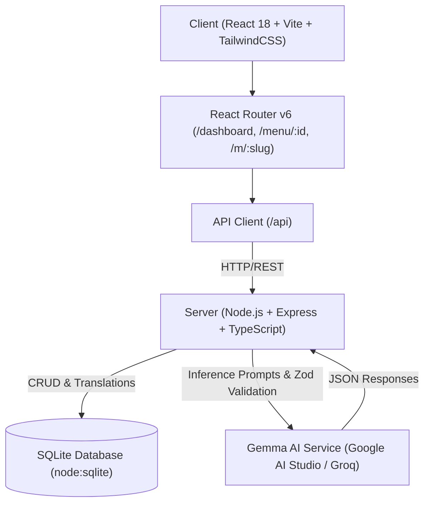

# 🍽️ MenuMate AI — Smart Multilingual Restaurant Menu Builder
> **Powered by Google Gemma 2 Open-Weight AI Models**

MenuMate AI empowers restaurants to effortlessly craft, manage, and publish QR-ready digital menus in **English** and **authentic Pakistani Urdu (Nastaliq script)**. By leveraging Google Gemma models via hosted inference, MenuMate AI solves the traditional hurdles of crude machine translation in gastronomy — preserving cultural nuances, authentic transliterations, and appetizing culinary tone.

---

## 🌟 Key Highlights & Features

### 1. 🤖 Gemma 2 AI Translation Studio
- **Bilingual Mastery**: Specializes in Pakistani and international cuisine (English ↔ Urdu).
- **Culinary Nuance**: Understands iconic culinary terms (e.g., *Chicken Karahi* ➔ *چکن کڑاہی*, *Dum Biryani* ➔ *شاہی دم بریانی*, *Daal Makhani* ➔ *دال مکھنی*) rather than awkward literal word-for-word substitutions.
- **Side-by-Side Review & Editing**: Restaurant owners can review, adjust, and approve translated titles, categories, and descriptions before publishing.
- **Provider Flexibility**: Supports **Google AI Studio** (`gemma-2-9b-it`, `gemma-2-27b-it`), **Groq Cloud** (`gemma2-9b-it`), or self-hosted OpenAI-compatible inference (Ollama, Together AI, vLLM).

### 2. 👨‍🍳 Gemma Chef AI Copywriter
- Craft mouthwatering, professional menu descriptions (15–30 words) from simple ingredient lists and cooking notes.
- **Strict Allergen Safety**: Explicitly constrained never to invent fake allergens or ingredients not provided by the chef.
- Auto-suggests dietary tags (e.g., `#halal`, `#spicy`, `#chef-special`, `#vegetarian`).

### 3. 📱 Customer-Facing Digital Menu (`/m/:slug`)
- **Fast, Mobile-First Web Experience**: Diners simply scan a QR code with their default camera — zero app installations required.
- **Instant Language Toggle**: Seamlessly switches between English (LTR) and Urdu (RTL) with genuine **Noto Nastaliq Urdu** and **Gulzar** typography.
- **Live Search & Dietary Filtering**: Instant filtering by tags (`Halal`, `Spicy`, `Vegetarian`, `Chef Special`, `Popular`).
- **Print & PDF Ready**: Dedicated print stylesheet formatted for physical table menus and takeaway flyers.

### 4. 🖨️ Table QR Code Generator
- High-fidelity QR code generation (SVG & PNG export).
- Instant printable "Scan & Dine" table tent preview for restaurant dining tables.

---

## 🏗️ Architecture & Technology Stack



- **Frontend**: React 18, Vite 6, TypeScript, Tailwind CSS, Lucide Icons, `qrcode.react`.
- **Backend**: Node.js, Express, TypeScript, native `node:sqlite` (zero native build dependencies), Zod validation.
- **AI Models**: Google Gemma 2 (`gemma-2-9b-it` / `gemma-2-27b-it`).
- **Typography**: Plus Jakarta Sans, Playfair Display, Noto Nastaliq Urdu, Gulzar.

---

## 🚀 Quick Start & Installation

### Prerequisites
- Node.js 18.0.0 or higher
- npm 9.0.0 or higher

### 1. Clone & Install Dependencies
```bash
git clone <repository-url>
cd "Dev challenge 2"
npm install
```

### 2. Configure Environment Variables
Copy the example environment configuration:
```bash
cp .env.example .env
```

Open `.env` and set your preferred Gemma provider and API key:
```ini
PORT=5000
NODE_ENV=development
DATABASE_PATH=./data/menumate.sqlite

# Gemma AI Provider (google | groq | openai_compatible)
GEMMA_PROVIDER=google

# Get a free key from Google AI Studio at https://aistudio.google.com/
GEMMA_API_KEY=your_gemma_api_key_here
GEMMA_MODEL=gemma-2-9b-it

# Public Base URL
APP_BASE_URL=http://localhost:5173
```

> **Note**: Even without a Gemma API key, you can explore the pre-seeded **Saffron Garden demo menu**, test the digital customer menu, and view bilingual translations out-of-the-box!

### 3. Seed Database
Initialize the database with the pre-configured Saffron Garden 4-course authentic Pakistani demo data:
```bash
npm run seed
```

### 4. Run Development Servers
Launch both backend and frontend concurrently:
```bash
npm run dev
```

- Frontend App: [http://localhost:5173](http://localhost:5173)
- Live Demo Menu: [http://localhost:5173/m/saffron-garden](http://localhost:5173/m/saffron-garden)
- Restaurant Dashboard: [http://localhost:5173/dashboard](http://localhost:5173/dashboard)
- Backend API Health: [http://localhost:5000/api/health](http://localhost:5000/api/health)

---

## 🧪 Testing

Run the automated test suite covering Zod schema validation, SQLite relational data integrity, Gemma JSON parsing guards, and URL construction:

```bash
npm test
```

All 12 unit and integration tests will execute against in-memory SQLite and mock fixtures.

---

## 📂 Project Structure

```
├── client/                     # Vite + React Frontend
│   ├── src/
│   │   ├── api/                # API client with typed fetch methods
│   │   ├── components/         # Modals, Navbar, Dish & Category Forms, QR Generator
│   │   ├── pages/              # HomePage, DashboardPage, MenuBuilderPage, PublicMenuPage
│   │   ├── types/              # Frontend TypeScript definitions
│   │   ├── index.css           # Tailwind base, Urdu typography & Print stylesheets
│   │   ├── App.tsx             # Route definitions
│   │   └── main.tsx            # Vite React entry point
│   └── package.json
│
├── server/                     # Express + TypeScript Backend
│   ├── src/
│   │   ├── db/                 # SQLite connection, schema & Saffron Garden seed script
│   │   ├── middleware/         # Zod request validators
│   │   ├── routes/             # Restaurant, Menu, Gemma AI, and Public routes
│   │   ├── services/           # GemmaService (Google AI Studio, Groq & OpenAI compatibility)
│   │   ├── types/              # Backend TypeScript interfaces
│   │   ├── config.ts           # Environment variable loader
│   │   └── index.ts            # Server entry point & static frontend fallback
│   └── package.json
│
├── tests/                      # Automated test suite
│   └── run-tests.ts            # 12 unit & integration tests
│
└── package.json                # Root monorepo workspace configuration
```

---

## 📜 License

This project is licensed under the [MIT License](LICENSE).
